# Piko development on this Windows PC: the complete beginner guide

> Repository edition: this file is kept in the Piko fork so the workflow travels with the source.

This guide explains the whole journey from editing Piko source code to producing a signed, patched
Instagram or X/Twitter APK. It is written for this exact workspace:

```text
C:\Users\Karim\Documents\tweaksMorphe
```

You do not need to install Gradle globally, change the machine-wide `JAVA_HOME`, copy credentials
into the repository, or run commands as Administrator. The toolchain and helper scripts are already
prepared.

> [!IMPORTANT]
> A successful Piko build is **not** a patched Android app. Building Piko creates an `.mpp` patch
> bundle. Morphe then applies that bundle to an original APK/APKM/XAPK and produces the patched APK.

---

## Table of contents

1. [The 60-second version](#1-the-60-second-version)
2. [The mental model: what each piece does](#2-the-mental-model-what-each-piece-does)
3. [Your workspace map](#3-your-workspace-map)
4. [The tools already installed](#4-the-tools-already-installed)
4A. [Recreating the complete environment from zero](#4a-recreating-the-complete-environment-from-zero)
5. [Before every coding session](#5-before-every-coding-session)
6. [Opening and navigating the code](#6-opening-and-navigating-the-code)
7. [How a Piko feature is built](#7-how-a-piko-feature-is-built)
8. [Patch anatomy in detail](#8-patch-anatomy-in-detail)
9. [A safe beginner editing workflow](#9-a-safe-beginner-editing-workflow)
10. [How to create a new patch](#10-how-to-create-a-new-patch)
11. [Fingerprints, bytecode and Smali](#11-fingerprints-bytecode-and-smali)
12. [Runtime extension code](#12-runtime-extension-code)
13. [Settings and strings](#13-settings-and-strings)
14. [How to compile Piko](#14-how-to-compile-piko)
15. [How to inspect the compiled bundle](#15-how-to-inspect-the-compiled-bundle)
16. [How to patch an APK/APKM/XAPK](#16-how-to-patch-an-apkapkmxapk)
17. [How to verify the output](#17-how-to-verify-the-output)
18. [Optional: installing on a phone](#18-optional-installing-on-a-phone)
19. [The complete daily development loop](#19-the-complete-daily-development-loop)
20. [Debugging and troubleshooting](#20-debugging-and-troubleshooting)
21. [Git without fear](#21-git-without-fear)
22. [Important safety rules](#22-important-safety-rules)
23. [Command cheat sheet](#23-command-cheat-sheet)
24. [Beginner glossary](#24-beginner-glossary)
25. [Your first-feature checklist](#25-your-first-feature-checklist)

---

## 1. The 60-second version

After editing code inside `piko`, run these commands in PowerShell:

```powershell
Set-Location 'C:\Users\Karim\Documents\tweaksMorphe'

# Check the environment.
.\verify-env.ps1 -Deep

# Compile your Piko source into an .mpp bundle.
.\build-piko.ps1

# Show which app versions the new bundle supports.
.\morphe.ps1 list-versions

# Patch the one test input kept in a dedicated folder.
.\patch-apks.ps1 `
  -InputDir .\apkFiles\fresh-apkpure `
  -OutputDir .\output\my-test
```

You want the last command to end like this:

```text
result : PATCHED (morphe exit 0)
Patched: 1   Skipped: 0   Failed: 0
```

The patched APK will then be under:

```text
C:\Users\Karim\Documents\tweaksMorphe\output\my-test\
```

That is the shortest usable workflow. The rest of this guide explains what it means, how to edit
real features, and how to diagnose problems without guessing.

---

## 2. The mental model: what each piece does

Piko is not an Android application. Piko is a collection of instructions that tell Morphe how to
modify another Android application.

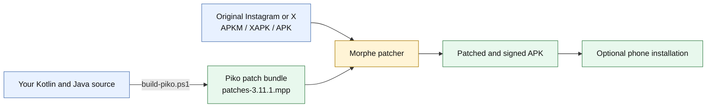

There are four separate success levels:

| Level | Question | Proof on this machine |
|---|---|---|
| 1. Compile | Does the source compile? | `build-piko.ps1` exits `0` |
| 2. Bundle | Was an `.mpp` produced? | Non-empty file with a SHA-256 hash |
| 3. Load | Can Morphe read the bundle? | `morphe.ps1 list-patches` exits `0` |
| 4. Patch | Can Morphe create a real signed APK? | `patch-apks.ps1` says `PATCHED`, exit `0` |

This workspace currently proves all four levels for Instagram `452.1.0.53.64`.

### The three kinds of code you will encounter

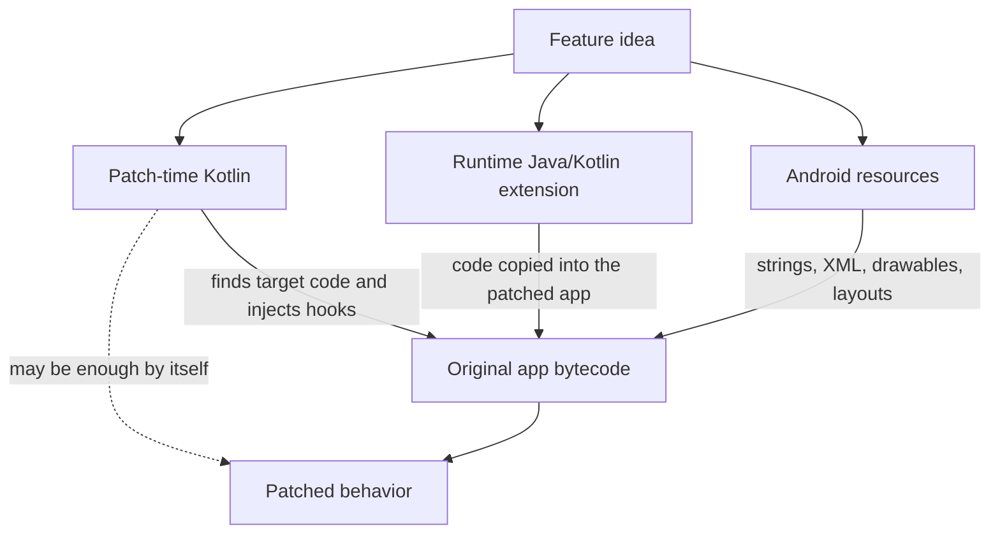

- **Patch-time Kotlin** runs on your PC while Morphe patches the app. It finds methods, changes
  bytecode, injects method calls, and edits resources.
- **Extension code** runs later inside Instagram or X on the phone. A patch usually injects a call
  from the original app into this code.
- **Resources** are XML strings, layouts, drawables and other Android assets included in the patched
  app.

Some features need only patch-time Kotlin. More advanced features usually need all three layers.

---

## 3. Your workspace map

```text
tweaksMorphe\
├── HOWTO.md                    ← this guide
├── DEVELOPMENT_SETUP.md        ← deep environment/setup reference
├── piko\                       ← the Piko Git repository; edit feature code here
│   ├── patches\                ← Kotlin patch definitions and patch resources
│   ├── extensions\             ← code that runs inside patched apps
│   ├── gradle\                 ← dependency version catalog and wrapper files
│   ├── gradlew.bat             ← repository-local Gradle launcher
│   └── gradle.properties       ← Piko version and Gradle settings
├── morphe-desktop\             ← local Morphe source and compiled CLI
├── apkFiles\                   ← original test APK/APKM/XAPK inputs
│   └── fresh-apkpure\          ← isolated supported Instagram test input
├── output\                     ← patched APKs and generated reports
├── logs\                       ← full logs from builds and patch runs
├── verify-env.ps1              ← checks repository, Java, SDK, auth and Gradle
├── build-piko.ps1              ← normal incremental Piko build
├── clean-build.ps1             ← clean Piko build, similar to CI
├── morphe.ps1                  ← inspect the newest local .mpp
├── patch-apks.ps1              ← patch one or more app bundles
├── build-morphe-cli.ps1        ← rebuild Morphe itself; normally unnecessary
└── install-toolchain.ps1       ← idempotent local JDK/SDK installer
```

### Files you normally edit

| Goal | Main location |
|---|---|
| Add or change an Instagram patch | `piko\patches\src\main\kotlin\app\crimera\patches\instagram\` |
| Add or change an X patch | `piko\patches\src\main\kotlin\app\crimera\patches\twitter\` |
| Add runtime Instagram behavior | `piko\extensions\instagram\src\main\java\app\morphe\extension\instagram\` |
| Add runtime X behavior | `piko\extensions\twitter\src\main\java\app\morphe\extension\twitter\` |
| Add strings/resources | `piko\patches\src\main\resources\` |
| Change supported app versions | the app's `utils\Constants.kt` file |

### Detailed Piko repository anatomy

```text
piko\
├── patches\
│   ├── build.gradle.kts
│   └── src\main\
│       ├── kotlin\
│       │   └── app\crimera\patches\
│       │       ├── instagram\
│       │       │   ├── ads\          ad and suggested-content patches
│       │       │   ├── entity\       reusable models/hooks discovered in Instagram
│       │       │   ├── filter\       story/content filtering
│       │       │   ├── links\        link, privacy and distraction-free behavior
│       │       │   ├── misc\         stories, settings, downloads, themes, UI and more
│       │       │   └── utils\        compatibility targets, descriptors and helpers
│       │       ├── twitter\
│       │       │   ├── ads\          timeline/recommendation filtering
│       │       │   ├── entity\       reusable target-app entities
│       │       │   ├── featureFlag\  feature-switch changes
│       │       │   ├── interaction\  download and interaction behavior
│       │       │   ├── link\         URL and share-link behavior
│       │       │   ├── logging\      diagnostic/response logging
│       │       │   ├── misc\         settings and general UI behavior
│       │       │   ├── premium\      feature changes related to premium UI
│       │       │   ├── timeline\     timeline rendering and behavior
│       │       │   └── utils\        compatibility targets, descriptors and helpers
│       │       └── shared\           patch helpers shared between apps
│       └── resources\
│           ├── addresources\         strings/resources injected into target apps
│           ├── instagram\            Instagram-specific packaged resources
│           └── twitter\              X/Twitter-specific packaged resources
├── extensions\
│   ├── instagram\src\main\java\app\morphe\extension\instagram\
│   │   ├── patches\                  runtime feature implementations
│   │   ├── settings\                 Piko settings UI and setting declarations
│   │   ├── utils\                    preferences, strings and Instagram helpers
│   │   ├── entity\                   runtime wrappers/models
│   │   └── theme\                    runtime theme handling
│   ├── twitter\src\main\java\app\morphe\extension\twitter\
│   │   ├── patches\                  runtime X feature implementations
│   │   ├── settings\                 X-side Piko settings
│   │   └── utils/classes as needed
│   ├── shared\                        code reused inside both patched apps
│   └── all\                           cross-app build-time extension pieces
├── gradle\
│   ├── libs.versions.toml              dependency versions
│   └── wrapper\                        pinned Gradle wrapper files
├── docs\                               project documentation
├── settings.gradle.kts                 modules, plugin repository and namespace setup
├── build.gradle.kts                    root build configuration
├── gradle.properties                   Piko version and Gradle options
└── gradlew.bat                         Windows Gradle wrapper
```

### “I want to change X—where do I look?”

| Desired change | Start here | Then inspect |
|---|---|---|
| Hide/change an Instagram UI element | `patches/.../instagram/links` or `misc` | Similar fingerprint + matching extension method |
| Change Instagram ads/content filtering | `patches/.../instagram/ads` or `filter` | Settings status and preference declaration |
| Change stories/reels behavior | `patches/.../instagram/misc/stories` | `extensions/instagram/.../patches` and `utils/Pref.java` |
| Add an Instagram settings toggle | Existing nearby Instagram patch | `SettingsStatus.java`, `Settings.java`, UI builder and strings |
| Change X timeline behavior | `patches/.../twitter/timeline` | Matching X extension runtime class |
| Change an X feature flag | `patches/.../twitter/featureFlag` | Existing `featureFlagPatch` helpers |
| Change downloads | App-specific `interaction/downloads` or `misc/download` | Extension download classes and strings |
| Add a string/title/summary | `patches/src/main/resources/addresources/values` | Translation folders and string validator |
| Support a newer app version | App `utils/Constants.kt` | Every fingerprint used by that app; full real-app regression test |
| Change how patching itself works | `patches` Kotlin | Morphe patcher APIs; do not put runtime logic here |
| Change behavior after app launch | App extension module | Add/inject an exact bytecode hook from patch Kotlin |

### Following one feature end to end

To understand a feature, trace it in this order:


Example searches:

```powershell
Set-Location 'C:\Users\Karim\Documents\tweaksMorphe\piko'

# Start from words shown in the Piko/Morphe UI.
rg -n -i 'hide story follow button' patches extensions

# Follow the runtime method name found in injected Smali.
rg -n 'storyFollowButtonState' patches extensions

# Follow the setting/status name.
rg -n 'hideStoryFollowButton|HIDE_STORY_FOLLOW' patches extensions

# Find the visible translated string key.
rg -n 'piko_hide_story_follow_button' patches\src\main\resources
```

### Files you normally do not edit

- Anything under `piko\.gradle`, `piko\build`, or a module's `build` directory. These are generated.
- `gradlew.bat` or Gradle wrapper files unless deliberately upgrading Gradle.
- Credentials in `%USERPROFILE%\.gradle\gradle.properties`.
- Original APK/APKM/XAPK files.
- The built `.mpp` directly. Always rebuild it from source.

---

## 4. The tools already installed

| Tool | Purpose |
|---|---|
| Temurin JDK 21 | Runs Gradle and the Morphe CLI |
| Android SDK platform 36 | Compiles Piko's Android code |
| Android Build Tools 36 and 37 | Android compilation, signing, alignment and verification |
| Gradle 9.8.2 wrapper | Builds Piko; invoked through `piko\gradlew.bat` |
| Morphe Desktop CLI 2.2.0 | Applies the `.mpp` to an app bundle |
| Git | Tracks and reviews source changes |
| GitHub CLI | Supplies package credentials securely from the Windows keyring |
| VS Code | Source editor |

The machine-wide `JAVA_HOME` intentionally remains on JDK 17. The helper scripts choose JDK 21 for
this workspace. Do not change the machine-wide value just for Piko.

> [!WARNING]
> The local `morphe-desktop` checkout contains an important source fix: an internal crash in D8's
> optional verifier is reported as a warning instead of falsely aborting a successful patch. Do not
> run `git reset --hard`, delete the checkout, or replace it casually. The currently built Morphe jar
> includes this fix.

---

## 4A. Recreating the complete environment from zero

This section is for a new Windows 11 computer, a deleted workspace, or a future you who remembers
nothing about the setup. There are two different things to recreate:

1. **The Piko source repository**—stored in your GitHub fork.
2. **The local development workspace**—JDK, Android SDK, Morphe, original test inputs, helper
   scripts, logs and outputs. These machine-specific pieces are intentionally not committed to Piko.

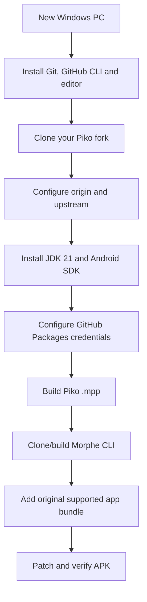

### 4A.1 What GitHub does and does not preserve

Your Piko fork preserves:

- Piko source under `patches` and `extensions`
- Gradle configuration and wrapper
- Git history and branches
- This `HOWTO.md`

Your fork does **not** preserve:

- Original or patched APK files
- GitHub authentication tokens
- User-level Gradle properties
- JDK/Android SDK installations
- The sibling `morphe-desktop` checkout
- Workspace-root PowerShell helpers
- Logs and build outputs

That separation is intentional. APKs, credentials and machine paths do not belong in a source-code
repository.

### 4A.2 Install base Windows tools

Open a normal, non-Administrator PowerShell. If Windows Package Manager is available:

```powershell
winget install --id Git.Git -e
winget install --id GitHub.cli -e
winget install --id Microsoft.VisualStudioCode -e
```

Close and reopen PowerShell so the new commands appear on `PATH`, then verify:

```powershell
git --version
gh --version
code --version
```

### 4A.3 Create the workspace and clone your fork

```powershell
$workspace = 'C:\Users\Karim\Documents\tweaksMorphe'
New-Item -ItemType Directory -Force $workspace | Out-Null
Set-Location $workspace

git clone https://github.com/carteeeltheboss/piko.git piko
```

Configure both remotes explicitly:

```powershell
git -C .\piko remote set-url origin https://github.com/carteeeltheboss/piko.git

if (-not (git -C .\piko remote | Select-String '^upstream$')) {
    git -C .\piko remote add upstream https://github.com/crimera/piko.git
}

git -C .\piko remote -v
```

Switch to the pushed development branch:

```powershell
git -C .\piko fetch --all --prune
git -C .\piko switch karim/dev
```

Configure safe push/pull direction:

```powershell
git -C .\piko config remote.pushDefault origin
git -C .\piko config push.default current
git -C .\piko config branch.karim/dev.remote upstream
git -C .\piko config branch.karim/dev.merge refs/heads/dev
```

Resulting data flow:

```text
git pull  → upstream/dev (crimera's source)
git push  → origin/karim/dev (your fork)
```

Always verify remotes before the first push on a new machine.

### 4A.4 Authenticate GitHub CLI and GitHub Packages

Sign in interactively:

```powershell
gh auth login
gh auth status
```

Piko resolves Morphe build dependencies from GitHub Packages, which needs `read:packages`:

```powershell
gh auth refresh -h github.com -s read:packages
```

The device/browser confirmation is intentionally interactive. Never paste the token into this
repository.

For the current PowerShell process, Gradle can use credentials from the GitHub CLI keyring:

```powershell
$env:GITHUB_ACTOR = (gh api user --jq .login).Trim()
$env:GITHUB_TOKEN = (gh auth token).Trim()
```

Do not print `$env:GITHUB_TOKEN` and do not put it in a script committed to Git.

For IDE builds that do not run through the workspace helpers, create this user-only file:

```text
%USERPROFILE%\.gradle\gradle.properties
```

It may contain:

```properties
gpr.user=YOUR_GITHUB_USERNAME
gpr.key=YOUR_GITHUB_TOKEN_WITH_READ_PACKAGES
org.gradle.java.installations.paths=C:/Users/Karim/dev-tools/jdk-21,C:/Program Files/Eclipse Adoptium/jdk-17.0.20.101-hotspot
```

Use forward slashes in the Java paths. This file is plaintext and must remain outside every
repository. On a differently named Windows account, replace `Karim` with that profile name.

### 4A.5 Install JDK 21

The exact workspace uses a user-local Temurin JDK 21 at:

```text
C:\Users\Karim\dev-tools\jdk-21
```

If you preserved the workspace-root helper scripts, the easiest recreation is:

```powershell
Set-Location 'C:\Users\Karim\Documents\tweaksMorphe'
.\install-toolchain.ps1
```

That script installs the user-local JDK and Android SDK without Administrator access and is
idempotent: running it again keeps correct existing components.

For a manual install, download a Temurin/OpenJDK 21 x64 archive from its official distributor,
extract it so `bin\java.exe` exists under the chosen JDK root, then verify:

```powershell
& 'C:\Users\Karim\dev-tools\jdk-21\bin\java.exe' -version
```

Set only user/workspace variables; do not replace an unrelated machine-wide Java installation:

```powershell
[Environment]::SetEnvironmentVariable(
    'PIKO_JAVA_HOME',
    'C:\Users\Karim\dev-tools\jdk-21',
    'User'
)
```

For a one-off raw build in the current terminal:

```powershell
$env:JAVA_HOME = 'C:\Users\Karim\dev-tools\jdk-21'
$env:Path = "$env:JAVA_HOME\bin;$env:Path"
```

### 4A.6 Install the Android SDK

The exact SDK root is:

```text
C:\Users\Karim\Android\Sdk
```

Required packages:

```text
cmdline-tools;latest
platform-tools
platforms;android-36
build-tools;36.0.0
build-tools;37.0.0
```

Why two Build Tools versions?

- Piko compiles against Android API/build tooling 36.
- Morphe uses the newest installed D8, `apksigner`, `zipalign` and `aapt2` from Build Tools 37.

With command-line tools already extracted, install packages like this:

```powershell
$sdkRoot = 'C:\Users\Karim\Android\Sdk'
$sdkManager = "$sdkRoot\cmdline-tools\latest\bin\sdkmanager.bat"

& $sdkManager --sdk_root=$sdkRoot `
  'platform-tools' `
  'platforms;android-36' `
  'build-tools;36.0.0' `
  'build-tools;37.0.0'

& $sdkManager --sdk_root=$sdkRoot --licenses
```

Persist user-level SDK paths:

```powershell
[Environment]::SetEnvironmentVariable('ANDROID_HOME', $sdkRoot, 'User')
[Environment]::SetEnvironmentVariable('ANDROID_SDK_ROOT', $sdkRoot, 'User')
[Environment]::SetEnvironmentVariable('PIKO_ANDROID_HOME', $sdkRoot, 'User')
```

Open a new PowerShell before testing persisted variables.

### 4A.7 Build Piko without the workspace helpers

The helper is preferred, but the raw equivalent is useful on a freshly cloned fork:

```powershell
Set-Location 'C:\Users\Karim\Documents\tweaksMorphe\piko'

$env:JAVA_HOME = 'C:\Users\Karim\dev-tools\jdk-21'
$env:ANDROID_HOME = 'C:\Users\Karim\Android\Sdk'
$env:ANDROID_SDK_ROOT = $env:ANDROID_HOME
$env:GITHUB_ACTOR = (gh api user --jq .login).Trim()
$env:GITHUB_TOKEN = (gh auth token).Trim()

.\gradlew.bat buildAndroid
```

Expected artifact:

```text
patches\build\libs\patches-3.11.1.mpp
```

Never install a global Gradle. The repository wrapper downloads and uses the pinned Gradle version.

### 4A.8 Recreate Morphe Desktop

From the workspace root:

```powershell
Set-Location 'C:\Users\Karim\Documents\tweaksMorphe'
git clone -b dev https://github.com/MorpheApp/morphe-desktop morphe-desktop
```

Build it with JDK 21 and GitHub Packages credentials:

```powershell
$env:JAVA_HOME = 'C:\Users\Karim\dev-tools\jdk-21'
$env:GITHUB_ACTOR = (gh api user --jq .login).Trim()
$env:GITHUB_TOKEN = (gh auth token).Trim()

Set-Location .\morphe-desktop
.\gradlew.bat build
Set-Location ..
```

Expected runnable jar:

```text
morphe-desktop\build\libs\morphe-desktop-*-all.jar
```

#### The local D8 verifier fix

At the time this guide was written, D8 8.10.9 and 9.2.4 both crashed internally while verifying
Instagram 452's rebuilt `classes.dex`, even though the completed APK later passed Morphe's whole-APK
verification, `apksigner`, `zipalign`, and real packaging. The local Morphe checkout contains a
narrow fix in:

```text
morphe-desktop\src\main\kotlin\app\morphe\engine\PatchEngine.kt
```

The fix wraps `SdkDexVerifier` and converts only this signature into a warning:

```text
d8 failed ... Compilation failed with an internal error
```

Every ordinary verification failure is still thrown. If recreating after upstream has fixed this,
use upstream's implementation. If the exact crash returns, compare your `PatchEngine.kt` with the
working workspace before rebuilding Morphe. Do not disable every verification error globally.

The workspace helper performs the build and keeps logs:

```powershell
.\build-morphe-cli.ps1 -Force
```

### 4A.9 Recreate workspace directories

```powershell
Set-Location 'C:\Users\Karim\Documents\tweaksMorphe'

New-Item -ItemType Directory -Force `
  .\apkFiles, `
  .\apkFiles\my-test, `
  .\output, `
  .\logs | Out-Null
```

Place exactly one original supported APK/APKM/XAPK in `apkFiles\my-test`. Do not commit it.

### 4A.10 Patch manually without helper scripts

```powershell
Set-Location 'C:\Users\Karim\Documents\tweaksMorphe'

$java = 'C:\Users\Karim\dev-tools\jdk-21\bin\java.exe'
$jar = (Get-ChildItem .\morphe-desktop\build\libs\*-all.jar |
        Sort-Object LastWriteTime -Descending |
        Select-Object -First 1).FullName
$mpp = (Get-ChildItem .\piko\patches\build\libs\*.mpp |
        Sort-Object LastWriteTime -Descending |
        Select-Object -First 1).FullName
$input = (Get-ChildItem .\apkFiles\my-test\* -File |
          Select-Object -First 1).FullName
$output = (Resolve-Path .\output).Path + '\patched-app.apk'

& $java -Xms1g -Xmx6g -jar $jar patch `
  --patches $mpp `
  --verify-with-sdk='C:\Users\Karim\Android\Sdk' `
  --out $output `
  $input

$LASTEXITCODE
```

Prefer `patch-apks.ps1` in the prepared workspace because it also enforces compatibility, deletes
partial failures, hashes outputs and writes reports.

### 4A.11 Final recreation acceptance test

A recreated environment is ready only when all of these pass:

```powershell
.\verify-env.ps1 -Deep
.\build-piko.ps1
.\morphe.ps1 list-patches
.\morphe.ps1 list-versions
.\patch-apks.ps1 -InputDir .\apkFiles\my-test -OutputDir .\output\recreation-test
```

Record the exit code, size and SHA-256 of both the `.mpp` and patched APK. “The command ran” is not
evidence; an exit-0 command and a verified artifact are evidence.

---

## 5. Before every coding session

Open PowerShell and run:

```powershell
Set-Location 'C:\Users\Karim\Documents\tweaksMorphe'
.\verify-env.ps1 -Deep
```

Expected ending:

```text
READY - 0 failed, 0 warning(s).
```

Then inspect the Piko repository before editing:

```powershell
git -C .\piko status --short
git -C .\piko branch --show-current
git -C .\piko log -1 --oneline
```

Expected facts:

- Branch: `karim/dev`
- A clean repository prints nothing for `git status --short`.
- `origin` is your fork.
- `upstream` is the original `crimera/piko` project and is read-only for your workflow.

If `git status --short` prints files, do not panic. It means you already have edits. Read the diff:

```powershell
git -C .\piko diff
```

Never destroy edits merely to make the status clean.

---

## 6. Opening and navigating the code

Open the actual Piko repository—not the parent workspace—as the VS Code project:

```powershell
Set-Location 'C:\Users\Karim\Documents\tweaksMorphe\piko'
code .
```

### Useful VS Code actions

- `Ctrl+P`: open a file by name.
- `Ctrl+Shift+F`: search the whole repository.
- `F12`: go to a definition when the Kotlin/Java language service understands it.
- `Shift+F12`: find references.
- `` Ctrl+` ``: open the integrated terminal.
- Markdown preview: open `HOWTO.md`, then press `Ctrl+Shift+V` to render tables and Mermaid diagrams.

### Search by copying an existing feature

The fastest way to learn Piko is to find a feature similar to yours:

```powershell
Set-Location 'C:\Users\Karim\Documents\tweaksMorphe\piko'

# Find patch names or descriptions.
rg -n 'name =|description =' patches\src\main\kotlin\app\crimera\patches\instagram

# Find every place a settings feature is enabled.
rg -n 'enableSettings' patches\src\main\kotlin\app\crimera\patches\instagram

# Find calls injected into extension code.
rg -n 'invoke-static|invoke-virtual' patches\src\main\kotlin\app\crimera\patches\instagram

# Find the runtime Java implementation for a class or method.
rg -n 'class Pref|storyFollowButtonState' extensions\instagram\src\main\java
```

`rg` means ripgrep. It is a fast text search. Searching the existing code is usually more reliable
than inventing new syntax from memory.

---

## 7. How a Piko feature is built

Consider a feature that hides an Instagram UI element only when the user enables a Piko setting.

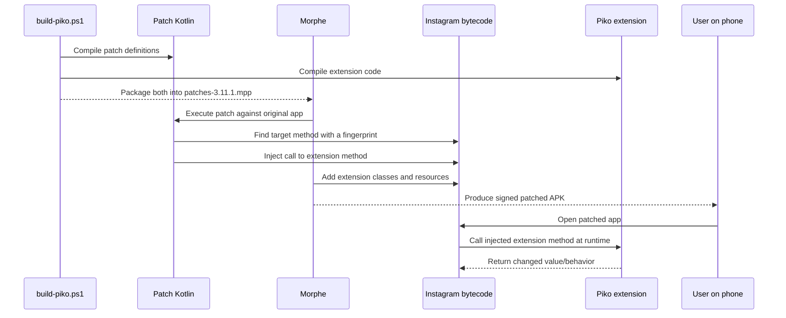

The key distinction is time:

| When | Code that runs | Environment |
|---|---|---|
| Build time | Gradle, Kotlin/Java compiler | Your PC |
| Patch time | `patch { execute { ... } }` Kotlin | Morphe on your PC |
| App runtime | Extension Java/Kotlin | Inside the patched Android app |

If you confuse patch time and runtime, designs become difficult. Ask: “Should this happen once while
constructing the APK, or every time the user performs an action in the app?”

---

## 8. Patch anatomy in detail

A typical patch has this shape:

```kotlin
@Suppress("unused")
val myFeaturePatch =
    patch(
        name = "My feature",
        description = "Explains what the feature changes.",
        default = true,
    ) {
        compatibleWith(COMPATIBILITY_INSTAGRAM)
        dependsOn(settingsPatch)

        execute {
            // Find target code, change bytecode/resources, and expose settings here.
        }
    }
```

This is a structural example, not a functional patch by itself.

### Meaning of each part

| Part | Meaning |
|---|---|
| `@Suppress("unused")` | The Gradle/Morphe plugin discovers the top-level value even though Kotlin sees no direct reference |
| `val myFeaturePatch` | Kotlin identifier used by dependency relationships |
| `patch(...)` | Declares a patch object |
| `name` | Human-readable name shown in Morphe |
| `description` | Human-readable explanation |
| `default` | Whether Morphe enables it automatically; omit only after checking existing conventions |
| `compatibleWith(...)` | Restricts the patch to supported packages and versions |
| `dependsOn(...)` | Ensures required patches/hooks/resources run first |
| `execute { ... }` | Patch-time code that modifies the target app |

### Automatic discovery

There is no central “register my patch” list. A top-level patch value in the `patches` module is
discovered by the Morphe Gradle plugin during the build. You normally create the Kotlin file and
rebuild; you do not manually add it to a registry.

### Compatibility constants

Instagram compatibility is defined in:

```text
piko\patches\src\main\kotlin\app\crimera\patches\instagram\utils\Constants.kt
```

X compatibility is defined in:

```text
piko\patches\src\main\kotlin\app\crimera\patches\twitter\utils\Constants.kt
```

Current supported versions are:

| App | Package | Supported version |
|---|---|---|
| Instagram | `com.instagram.android` | `452.1.0.53.64`, ARM64 version code `385811006` |
| X/Twitter | `com.twitter.android` | `12.19.1-release.0` |

Do not declare a version compatible merely because it installs. A version is compatible only after
its fingerprints resolve and the patched app behaves correctly.

---

## 9. A safe beginner editing workflow

Use this loop for every change, even a tiny one:

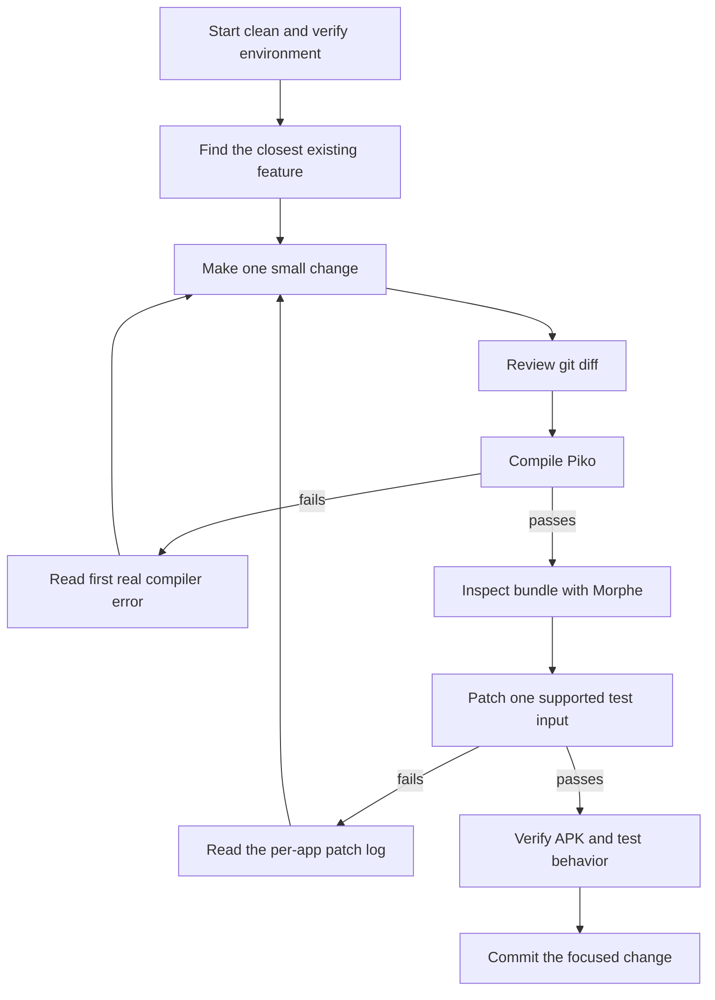

### Step 1: record the starting state

```powershell
git -C .\piko status --short
git -C .\piko diff
```

### Step 2: make one conceptual change

Avoid changing a fingerprint, extension method, settings UI and unrelated formatting all at once.
Small changes produce readable errors and readable Git diffs.

### Step 3: review before compiling

```powershell
git -C .\piko diff --check
git -C .\piko diff --stat
git -C .\piko diff
```

- `diff --check` finds whitespace mistakes.
- `diff --stat` shows which files changed.
- `diff` shows the exact lines.

### Step 4: compile incrementally

```powershell
Set-Location 'C:\Users\Karim\Documents\tweaksMorphe'
.\build-piko.ps1
```

### Step 5: patch only after compilation succeeds

```powershell
.\patch-apks.ps1 `
  -InputDir .\apkFiles\fresh-apkpure `
  -OutputDir .\output\my-feature-test
```

### Step 6: test the actual behavior

Compilation proves syntax and types. Patching proves fingerprints and bytecode operations. Only
running the app proves that the feature behaves correctly.

---

## 10. How to create a new patch

### 10.1 Decide what kind of feature it is

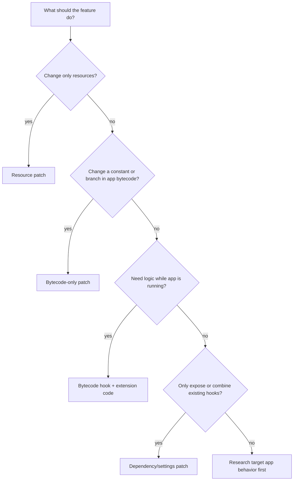

### 10.2 Find the nearest example

For an Instagram setting and injected extension call, study:

```text
patches\src\main\kotlin\app\crimera\patches\instagram\misc\stories\HideStoryFollowButtonPatch.kt
extensions\instagram\src\main\java\app\morphe\extension\instagram\utils\Pref.java
```

For a patch that mostly composes existing hooks, study:

```text
patches\src\main\kotlin\app\crimera\patches\instagram\misc\externalDownloader\ExternalDownloaderPatch.kt
```

### 10.3 Create a feature directory

Use the existing package hierarchy. Example:

```text
piko\patches\src\main\kotlin\app\crimera\patches\instagram\misc\myFeature\MyFeaturePatch.kt
```

The Kotlin `package` line must match the directory convention:

```kotlin
package app.crimera.patches.instagram.misc.myFeature
```

### 10.4 Add the patch definition

Start by copying the closest real patch, then change only what you understand:

```kotlin
package app.crimera.patches.instagram.misc.myFeature

import app.crimera.patches.instagram.utils.Constants.COMPATIBILITY_INSTAGRAM
import app.morphe.patcher.patch.patch

@Suppress("unused")
val myFeaturePatch =
    patch(
        name = "My feature",
        description = "Describe the visible behavior clearly.",
        default = false,
    ) {
        compatibleWith(COMPATIBILITY_INSTAGRAM)

        execute {
            // Real patch logic goes here.
        }
    }
```

Again, this compiles only after imports and logic are valid; it does not change app behavior until
the `execute` block performs a real modification.

### 10.5 Add dependencies deliberately

If you inject a call into extension code, find how that extension enters the app. If you expose a
Piko setting, the patch usually depends on the relevant `settingsPatch`. Never add dependencies at
random to silence an error.

```kotlin
dependsOn(settingsPatch)
```

Dependencies form a graph:

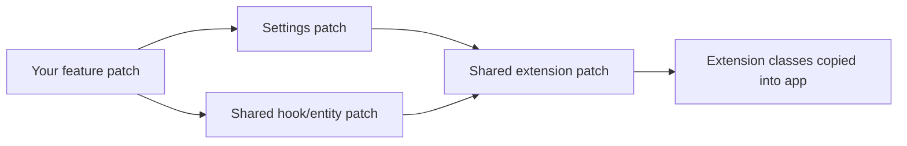

### 10.6 Compile immediately

Do not write hundreds of lines before the first build:

```powershell
Set-Location 'C:\Users\Karim\Documents\tweaksMorphe'
.\build-piko.ps1
```

Fix structural problems early, then add the actual fingerprint and hook in small steps.

---

## 11. Fingerprints, bytecode and Smali

This is the hardest part of patch development. You do not need to master it on day one, but you do
need a correct mental model.

### What a fingerprint does

Android production apps are obfuscated. A method name may change between releases, so a patch often
cannot safely search by name. A fingerprint searches for a combination of characteristics:

- Defining class or class pattern
- Return type
- Parameter types
- String constants
- Numeric literals
- Called methods
- Opcode sequence
- Resource identifiers

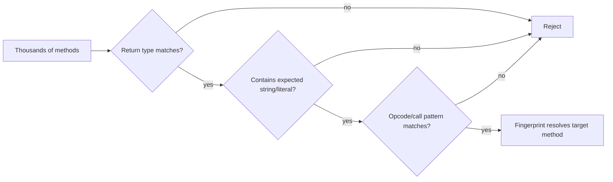

### A fingerprint should be specific but not fragile

Too broad:

- Matches several methods.
- Uses only a common return type or common string.
- Can silently modify the wrong method.

Too fragile:

- Requires a long exact opcode sequence.
- Depends on an obfuscated class name that changes every release.
- Breaks when the compiler reorders harmless instructions.

Prefer multiple meaningful signals and explicit validation after matching.

### Patch-time failures are different from compile failures

The Kotlin compiler can verify that `Fingerprint` is used correctly as Kotlin. It cannot know
whether a method in Instagram matches it. That is discovered only while patching the real app.

| Failure time | Typical cause |
|---|---|
| Compile time | Invalid Kotlin, missing import, wrong API call |
| Patch time | Fingerprint not found, wrong instruction index, register assumption failed |
| Runtime | Hook signature wrong, null value, wrong threading, incorrect setting behavior |

### Smali register basics

Smali is a readable representation of Dalvik bytecode.

- `v0`, `v1`, ... are local registers.
- `p0`, `p1`, ... are parameter registers.
- In an instance method, `p0` is normally `this`.
- A method return value is usually captured by a `move-result*` immediately after an `invoke-*`.

Example injected instructions:

```smali
invoke-static/range {v3 .. v3}, Lapp/morphe/extension/instagram/utils/Pref;->changeValue(I)I
move-result v3
```

Meaning:

1. Pass integer register `v3` to the extension method.
2. Receive the returned integer.
3. Store it back into `v3` so the original app continues with the modified value.

### Method descriptors

```text
Lpackage/path/ClassName;->methodName(Parameters)ReturnType
```

Common type codes:

| Code | Type |
|---|---|
| `V` | void |
| `Z` | boolean |
| `I` | int |
| `J` | long |
| `F` | float |
| `D` | double |
| `Ljava/lang/String;` | Java String object |
| `[I` | int array |

Example:

```text
Lapp/example/Feature;->enabled(Ljava/lang/String;)Z
```

This means a static/instance method named `enabled` that accepts a `String` and returns a boolean.

### Registers are where dangerous mistakes happen

Do not assume a hard-coded register is free. Existing Piko helpers such as `registersUsed`,
`parameterRegisterStart`, and `findFreeRegister` exist to reduce register corruption. Copy the
pattern used by a nearby, working patch and validate assumptions with `PatchException`.

Good patch behavior is fail-fast: if the target shape is unexpected, abort patching with a useful
message instead of producing subtly corrupted bytecode.

---

## 12. Runtime extension code

Use extension code when a feature must make decisions while the app is running.

Example architecture:

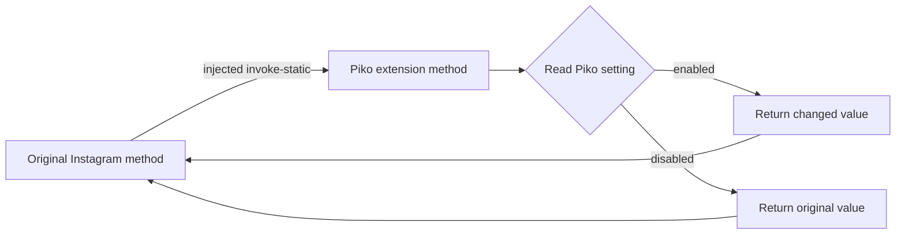

Instagram extension source lives under:

```text
piko\extensions\instagram\src\main\java\app\morphe\extension\instagram\
```

X extension source lives under:

```text
piko\extensions\twitter\src\main\java\app\morphe\extension\twitter\
```

### Hook signature must match exactly

If your patch injects:

```smali
invoke-static {v2}, Lapp/morphe/extension/instagram/patches/MyFeature;->transform(I)I
```

the extension needs a compatible method:

```java
package app.morphe.extension.instagram.patches;

public final class MyFeature {
    private MyFeature() {}

    public static int transform(int originalValue) {
        return originalValue;
    }
}
```

The package, class, method name, static/instance nature, parameter types and return type must all
agree. A mismatch may patch successfully and then crash at runtime with a linkage error.

### Keep hooks defensive

- Preserve original behavior when your feature is disabled.
- Handle `null` where the app may pass it.
- Avoid slow disk/network work on UI hooks.
- Avoid throwing across the app/extension boundary.
- Log only when necessary; never log credentials or private user data.
- Keep Android API compatibility in mind.

### Patch code versus extension code

| Task | Correct home |
|---|---|
| Find an obfuscated app method | Patch Kotlin |
| Inject a call | Patch Kotlin |
| Read a user preference while app runs | Extension code |
| Change a runtime value conditionally | Extension code |
| Add a string or XML layout | Patch resources |

---

## 13. Settings and strings

A complete user-facing setting often touches several locations:

```mermaid
flowchart TD
    A[Patch execute block] -->|enableSettings("myFeature")| B[SettingsStatus.java]
    B --> C[Settings UI decides feature is present]
    C --> D[BooleanSetting/StringSetting declaration]
    D --> E[Preference widget shown to user]
    E --> F[Extension reads stored value]
    G[Resource strings] --> E
```

### Instagram settings availability

The patch-time helper is:

```text
piko\patches\src\main\kotlin\app\crimera\patches\instagram\utils\Utils.kt
```

Calling:

```kotlin
enableSettings("myFeature")
```

injects a call to a corresponding method in:

```text
piko\extensions\instagram\src\main\java\app\morphe\extension\instagram\settings\SettingsStatus.java
```

Therefore, the method name must exist and match exactly. Study a nearby existing feature before
adding a new one.

### Preference declarations

Instagram's central settings declarations are in:

```text
piko\extensions\instagram\src\main\java\app\morphe\extension\instagram\settings\Settings.java
```

The codebase uses types such as `BooleanSetting` and `StringSetting`. These can also carry restart
requirements. Do not create a second preference system.

### Resource strings

Patch resources live under:

```text
piko\patches\src\main\resources\addresources\values\
```

There are subdirectories for shared, Instagram, Twitter and translated resources. Use a unique,
descriptive resource key. Keep formatting placeholders consistent across translations.

Run the dedicated string validation task when editing strings:

```powershell
Set-Location 'C:\Users\Karim\Documents\tweaksMorphe\piko'
.\gradlew.bat :patches:checkStringResources
```

Then return to the workspace root:

```powershell
Set-Location ..
```

Do not “fix” string validation by deleting translations or suppressing the check. Correct the
placeholder or resource structure.

---

## 14. How to compile Piko

Always launch builds from the workspace root through the helper scripts unless debugging Gradle
itself.

### Normal incremental build

```powershell
Set-Location 'C:\Users\Karim\Documents\tweaksMorphe'
.\build-piko.ps1
```

The script:

1. Resolves the Piko repository.
2. Selects the correct JDK.
3. Selects the Android SDK.
4. Retrieves GitHub Packages credentials process-locally.
5. Deletes stale `.mpp` bundles.
6. Runs `gradlew.bat buildAndroid`.
7. Verifies that the new bundle exists and begins with a ZIP header.
8. Prints size, timestamp, source commit and SHA-256.

Expected ending:

```text
Gradle finished with exit code 0
Generated patch bundle(s):
  ...\piko\patches\build\libs\patches-3.11.1.mpp
BUILD OK
```

### Clean build

Use this after changing branches, changing dependencies, seeing suspicious incremental behavior, or
before an important handoff:

```powershell
.\clean-build.ps1
```

It runs the equivalent of:

```text
gradlew clean buildAndroid
```

It is slower because it discards generated build output.

### Raw Gradle commands

Useful when diagnosing one module or task:

```powershell
Set-Location 'C:\Users\Karim\Documents\tweaksMorphe\piko'

# Full Android patch bundle.
.\gradlew.bat buildAndroid

# Compile only the patch Kotlin task and its dependencies.
.\gradlew.bat :patches:compileKotlin

# Validate resource strings.
.\gradlew.bat :patches:checkStringResources

# Display available tasks.
.\gradlew.bat tasks
```

Do not install a global Gradle and do not replace `gradlew.bat` with `gradle`. The wrapper pins the
correct version.

### Where the compiled bundle goes

```text
C:\Users\Karim\Documents\tweaksMorphe\piko\patches\build\libs\patches-3.11.1.mpp
```

The filename version comes from `piko\gradle.properties`.

---

## 15. How to inspect the compiled bundle

Before patching a large app, make sure Morphe accepts the bundle.

### List every patch

```powershell
Set-Location 'C:\Users\Karim\Documents\tweaksMorphe'
.\morphe.ps1 list-patches
```

### Save the patch list

```powershell
.\morphe.ps1 list-patches '--out=logs\my-patch-list.txt'
```

### List supported versions

```powershell
.\morphe.ps1 list-versions
```

### Filter the patch list by package

```powershell
.\morphe.ps1 list-patches -p -v -f com.instagram.android
.\morphe.ps1 list-patches -p -v -f com.twitter.android
```

If a new top-level patch does not appear:

1. Confirm the new file is inside `patches\src\main\kotlin`.
2. Confirm it declares a top-level `val` using `patch(...)`.
3. Confirm the build used your current source and produced a fresh `.mpp`.
4. Confirm `morphe.ps1` selected that newest `.mpp`.
5. Read the build log under `logs\`.

---

## 16. How to patch an APK/APKM/XAPK

### 16.1 Use an original supported app bundle

For the current Instagram patches, use:

```text
Instagram 452.1.0.53.64
ARM64 version code 385811006
```

Do not unsplit, modify or re-sign the input before Morphe receives it. Keep the original container.

### 16.2 Use a dedicated input folder

`patch-apks.ps1` scans the selected input directory. A dedicated directory prevents accidentally
patching the unsupported 455 file or two copies of the same version.

Example setup for a new test:

```powershell
Set-Location 'C:\Users\Karim\Documents\tweaksMorphe'

New-Item -ItemType Directory -Force .\apkFiles\my-test | Out-Null
Copy-Item -LiteralPath 'C:\path\to\your\supported-input.apkm' `
  -Destination .\apkFiles\my-test\
```

Keep only the intended test input in `apkFiles\my-test`.

> [!IMPORTANT]
> The helper parses package/version information from APKMirror-style filenames before patching.
> Avoid renaming the file to something vague such as `instagram.apkm`; otherwise it may be reported
> as unsupported even when its internal app version is correct.

### 16.3 Patch the dedicated folder

```powershell
.\patch-apks.ps1 `
  -InputDir .\apkFiles\my-test `
  -OutputDir .\output\my-test
```

The script:

1. Finds the newest local `.mpp`.
2. Finds the newest built Morphe CLI jar.
3. Asks the bundle which app versions it supports.
4. Marks each input `SUPPORTED` or `UNSUPPORTED`.
5. Skips unsupported versions unless you explicitly use `-Force`.
6. Applies Piko patches with a 6 GB Java heap limit.
7. Signs the output.
8. Deletes partial APK/JSON outputs when Morphe fails.
9. Writes a Markdown summary and JSON report.

### 16.4 Understand outcomes

| Outcome | Meaning | What to do |
|---|---|---|
| `PATCHED`, exit `0` | Signed APK produced successfully | Verify and test it |
| `SKIPPED` | Version is not declared compatible | Use the supported version |
| `FAILED`, numeric exit | Patching/building/signing failed | Read the named log |

### 16.5 Useful patch script switches

| Switch | Purpose | Beginner advice |
|---|---|---|
| `-InputDir <path>` | Choose input folder | Always use a dedicated folder |
| `-OutputDir <path>` | Choose output folder | Use a new name per feature/test |
| `-ContinueOnError` | Continue after one failure | Useful only for a batch of independent inputs |
| `-Force` | Try an unsupported app version | Experimental; never call the result proven |
| `-NoVerify` | Disable optional SDK verification | Normally leave verification enabled |
| `-Install` | Ask Morphe to install through ADB | Use only with an intended connected device |

Do not use `-Force` merely to turn a red result green. Compatibility failures often mean a
fingerprint no longer matches the target version.

### 16.6 Known working command on this machine

```powershell
.\patch-apks.ps1 `
  -InputDir .\apkFiles\fresh-apkpure `
  -OutputDir .\output\fresh-apkpure
```

Known verified output:

```text
output\fresh-apkpure\patched_com.instagram.android_452.1.0.53.64.apk
```

---

## 17. How to verify the output

The patch script already checks that output exists, is non-empty and has a SHA-256 hash. For an
important build, perform independent Android checks too.

```powershell
Set-Location 'C:\Users\Karim\Documents\tweaksMorphe'

$apk = (Resolve-Path '.\output\my-test\patched_com.instagram.android_452.1.0.53.64.apk').Path
$buildTools = 'C:\Users\Karim\Android\Sdk\build-tools\37.0.0'

# Record exact bytes and a cryptographic fingerprint.
Get-Item $apk | Select-Object FullName, Length, LastWriteTime
Get-FileHash $apk -Algorithm SHA256

# Verify the APK signature.
& "$buildTools\apksigner.bat" verify --verbose --print-certs $apk

# Verify ZIP alignment.
& "$buildTools\zipalign.exe" -c -v 4 $apk

# Inspect package name and version.
& "$buildTools\aapt2.exe" dump badging $apk |
  Select-String -Pattern '^package:', '^sdkVersion:', '^targetSdkVersion:'
```

For the currently proven Instagram artifact:

| Property | Verified value |
|---|---|
| Morphe exit | `0` |
| Size | `161,325,764` bytes |
| SHA-256 | `1184BE3721558779A8086842F00A15E329D4547D72657792DC15AC6300E6200F` |
| Signature | APK Signature Scheme v2, one signer, `CN=Morphe` |
| Alignment | `zipalign` verification successful |
| Package | `com.instagram.android` |
| Version name | `452.1.0.53.64` |

A SHA-256 hash is not a quality score. It is an exact identity. If one byte changes, the hash
changes. Record it when sharing test results so everyone knows which artifact was tested.

---

## 18. Optional: installing on a phone

Creating a valid APK and running it successfully are different proof levels. Device installation is
optional and was not performed automatically.

### 18.1 Prepare the phone

1. Enable Developer options.
2. Enable USB debugging.
3. Connect the phone by USB.
4. Accept the authorization prompt on the phone.

### 18.2 Confirm ADB sees it

```powershell
$adb = 'C:\Users\Karim\Android\Sdk\platform-tools\adb.exe'
& $adb devices
```

Expected:

```text
List of devices attached
DEVICE_SERIAL    device
```

`unauthorized` means the phone has not accepted the debugging prompt.

### 18.3 Understand the signing conflict

The patched APK is signed with Morphe's key, not Instagram's Play Store key. If it keeps the same
package name, Android cannot use it as an update over the official app and cannot install two copies
with the same package name.

Your choices are:

- Back up important app data, uninstall the official app, then install the patched app.
- Enable/configure Piko's opt-in **Clone** patch so the patched app uses a different package name.

Uninstalling an app normally deletes its local app data. Do not do it casually.

### 18.4 Install a prepared artifact

```powershell
$apk = (Resolve-Path '.\output\my-test\patched_com.instagram.android_452.1.0.53.64.apk').Path
& $adb install $apk
```

For reinstalling a build signed with the same local Morphe key:

```powershell
& $adb install -r $apk
```

Or allow the patch script to request installation:

```powershell
.\patch-apks.ps1 `
  -InputDir .\apkFiles\my-test `
  -OutputDir .\output\my-test `
  -Install
```

Only use `-Install` when you know exactly which ADB device is connected.

---

## 19. The complete daily development loop

Copy this checklist into your notes for each feature.

### Phase A: prepare

```powershell
Set-Location 'C:\Users\Karim\Documents\tweaksMorphe'
.\verify-env.ps1 -Deep
git -C .\piko status --short
```

### Phase B: edit

```powershell
code .\piko
```

Make one focused change. Save all files.

### Phase C: review source changes

```powershell
git -C .\piko diff --check
git -C .\piko diff --stat
git -C .\piko diff
```

### Phase D: compile

```powershell
.\build-piko.ps1
```

### Phase E: confirm bundle contents

```powershell
.\morphe.ps1 list-versions
.\morphe.ps1 list-patches -f com.instagram.android
```

### Phase F: patch one supported input

```powershell
$run = Get-Date -Format 'yyyyMMdd-HHmmss'
.\patch-apks.ps1 `
  -InputDir .\apkFiles\fresh-apkpure `
  -OutputDir ".\output\feature-test-$run"
```

Using a timestamped output folder prevents one run from hiding another.

### Phase G: verify and record

Record:

- Git commit or current diff
- `.mpp` SHA-256
- Input filename/version/hash
- Morphe exit code
- Output APK path/size/hash
- Device model and Android version, if installed
- Expected behavior
- Actual behavior

### Phase H: commit when the change is coherent

```powershell
git -C .\piko status --short
git -C .\piko diff --check
git -C .\piko add path\to\the\files\you\intended
git -C .\piko diff --cached
git -C .\piko commit -m "feat(Instagram): describe the feature"
```

Do not use `git add -A` blindly. Stage the files you actually intended to change, then inspect the
staged diff.

---

## 20. Debugging and troubleshooting

### Start with the correct evidence

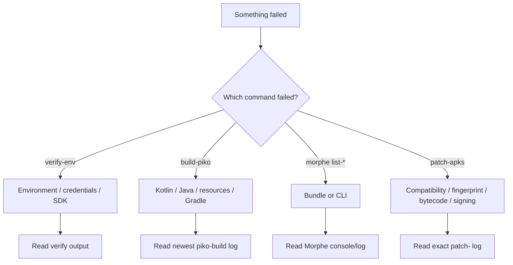

Do not debug a patch-time fingerprint problem by repeatedly cleaning Gradle. Do not debug a Kotlin
compiler error by downloading a different APK. Identify the layer first.

### Find the newest logs

```powershell
Get-ChildItem .\logs -File |
  Sort-Object LastWriteTime -Descending |
  Select-Object -First 15 Name, Length, LastWriteTime
```

Read the tail of a log:

```powershell
Get-Content .\logs\the-log-file.log -Tail 80
```

### Common build problems

#### `Unresolved reference`

Likely causes:

- Missing or incorrect import
- Typo in class/method/variable name
- API copied from another Morphe/Piko version
- File placed in the wrong module

Fix the **first** meaningful compiler error first; later errors may be consequences.

#### Kotlin package does not match the directory

Kotlin technically allows this, but inconsistent package paths make imports and navigation confusing.
Follow the existing hierarchy exactly.

#### String-resource validation fails

Run:

```powershell
Set-Location .\piko
.\gradlew.bat :patches:checkStringResources
Set-Location ..
```

Compare placeholders such as `%s`, `%1$s`, `%d` across translations.

#### HTTP 401 from GitHub Packages

The Morphe Gradle plugin and libraries are hosted on GitHub Packages. First run:

```powershell
.\verify-env.ps1 -Deep
```

Do not paste a token into the repository. Credentials belong in the Windows keyring and user-level
Gradle properties.

#### Java class-file version error

You ran Morphe with the wrong Java. Use the provided scripts, which select JDK 21:

```powershell
.\morphe.ps1 list-versions
```

Do not call the Morphe jar with the machine's default JDK 17.

### Common patch problems

#### `SKIPPED` / unsupported version

Run:

```powershell
.\morphe.ps1 list-versions
```

Use the declared supported version. Instagram `455.0.0.51.72` is currently unsupported.

#### Fingerprint not found

The app version does not contain the shape your fingerprint expects, or the fingerprint is wrong.

1. Confirm the exact app version and version code.
2. Confirm `compatibleWith` is correct.
3. Inspect the nearest working fingerprint.
4. Add meaningful diagnostics and validation.
5. Do not use `-Force` as a substitute for adapting the patch.

#### Register or instruction mismatch

Stop and inspect the target method. Do not keep changing indexes until it “works.” Validate the
instruction type, registers, called method and surrounding branch structure.

#### D8 prints an internal verification warning

The local Morphe build recognizes only D8's own `Compilation failed with an internal error` as a
non-fatal verifier crash. Other verifier failures still abort. A warning is preserved in the log;
the final APK must still pass signing/alignment checks and real device testing.

#### A partial APK appeared after failure

The current script deletes APK and JSON output when Morphe exits non-zero. If you find an old
artifact from a historical run, do not trust it. Trust only a `PATCHED`, exit-0 run with a recorded
hash.

### When to clean

Clean when:

- Switching significantly different branches
- Upgrading dependencies/plugin versions
- Incremental output seems inconsistent with source
- Preparing a release-quality verification

Do not clean for every typo; incremental builds are faster and appropriate for normal work.

### If the same failure repeats twice

Stop repeating it. Preserve the log, input hash, bundle hash and exact command. Change one hypothesis
at a time. Repetition without new evidence consumes time and can overwrite useful artifacts.

---

## 21. Git without fear

Git is your safety net. It lets you see and recover changes, but destructive commands can also erase
work when used carelessly.

### See your current state

```powershell
git -C .\piko status
git -C .\piko diff
git -C .\piko diff --cached
```

- `git diff` shows unstaged edits.
- `git diff --cached` shows what will be committed.
- Untracked files appear in `git status` but not ordinary `git diff`.

### Commit a focused change

```powershell
git -C .\piko add patches\src\main\kotlin\app\crimera\patches\instagram\misc\myFeature\MyFeaturePatch.kt
git -C .\piko add extensions\instagram\src\main\java\app\morphe\extension\instagram\patches\MyFeature.java
git -C .\piko diff --cached
git -C .\piko commit -m "feat(Instagram): add my feature"
```

Only list files that truly belong to the same change.

### Your remotes

```powershell
git -C .\piko remote -v
```

Conceptually:

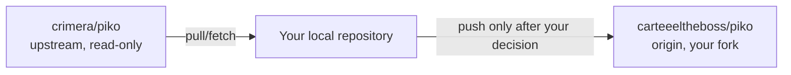

The branch is intentionally configured so a normal push targets your fork, not upstream. This guide
does not push anything automatically.

### Commands to avoid as a beginner

Do not casually run:

```text
git reset --hard
git clean -fd
git checkout -- <file>
```

These can destroy uncommitted work. First inspect status and diff, and make a commit or backup.

---

## 22. Important safety rules

### Protect credentials

- Never paste GitHub tokens into source files, logs, screenshots or chat.
- Never add `%USERPROFILE%\.gradle\gradle.properties` to the repository.
- Use helper scripts so credentials remain process-scoped.

### Protect original app files

- Keep original APK/APKM/XAPK inputs unchanged.
- Patch into `output`, never overwrite the input.
- Record input and output hashes.
- Use apps you are authorized to test and do not redistribute proprietary patched apps.

### Protect source work

- Inspect `git status` before automated cleanup.
- Do not delete `piko` build/source folders broadly.
- Do not modify generated build files as if they were source.
- Keep helper scripts outside the Piko repository.

### Protect the device

- Know which device `adb devices` lists.
- Back up data before uninstalling the official app.
- Do not use `-Install` unless installation is intentional.
- Test new hooks on a disposable/test account when possible.

---

## 23. Command cheat sheet

Run these from:

```text
C:\Users\Karim\Documents\tweaksMorphe
```

| Task | Command |
|---|---|
| Check environment | `.\verify-env.ps1 -Deep` |
| Open Piko in VS Code | `code .\piko` |
| Inspect Git state | `git -C .\piko status --short` |
| Review edits | `git -C .\piko diff` |
| Normal build | `.\build-piko.ps1` |
| Clean build | `.\clean-build.ps1` |
| Validate strings | `Set-Location .\piko; .\gradlew.bat :patches:checkStringResources; Set-Location ..` |
| List patch names | `.\morphe.ps1 list-patches` |
| List supported app versions | `.\morphe.ps1 list-versions` |
| Patch isolated input | `.\patch-apks.ps1 -InputDir .\apkFiles\my-test -OutputDir .\output\my-test` |
| Find newest logs | `Get-ChildItem .\logs -File | Sort-Object LastWriteTime -Descending | Select-Object -First 10` |
| Hash an artifact | `Get-FileHash .\output\my-test\patched_*.apk -Algorithm SHA256` |
| Check connected devices | `& 'C:\Users\Karim\Android\Sdk\platform-tools\adb.exe' devices` |

### Exit-code interpretation

PowerShell exposes a native program's latest exit code as `$LASTEXITCODE`:

```powershell
.\build-piko.ps1
$LASTEXITCODE
```

- `0` normally means success.
- Non-zero means failure or an environment problem; read the script's summary and log.

---

## 24. Beginner glossary

| Term | Plain-English meaning |
|---|---|
| APK | A single installable Android application package |
| APKM/XAPK/APKS | A bundle containing a base APK plus split APKs/resources |
| `.mpp` | Morphe patch bundle containing compiled patch logic, extensions and resources |
| Patch | Instructions that modify a target Android app |
| Extension | Code injected into the app and executed at runtime |
| Fingerprint | A structured search that finds obfuscated methods/instructions |
| Smali | Human-readable assembly form of Android Dalvik bytecode |
| DEX | Android bytecode file, usually named `classes.dex` |
| Resource | Android string, layout, image, XML or ID data |
| Gradle | Build system used to compile/package Piko |
| Gradle wrapper | Repository-pinned Gradle launcher: `gradlew.bat` |
| JDK | Java development kit used by Gradle/Morphe |
| Android SDK | Android compilers, platform APIs and device tools |
| D8/R8 | Android bytecode compiler/optimizer tools |
| ADB | Android Debug Bridge for communicating with a device |
| SHA-256 | Cryptographic hash identifying exact file contents |
| Git working tree | Your checked-out source files and uncommitted edits |
| Staged | Selected Git changes prepared for the next commit |
| `origin` | Your GitHub fork |
| `upstream` | Original Piko GitHub repository |
| CI | Automated build/check system, such as GitHub Actions |

---

## 25. Your first-feature checklist

### Design

- [ ] I can describe the feature in one sentence.
- [ ] I found the closest existing Piko feature.
- [ ] I know whether the change belongs in patch Kotlin, extension code, resources, or several.
- [ ] I know which supported app/version I will test.

### Implementation

- [ ] The patch is under the correct Instagram or Twitter package path.
- [ ] It has a clear name and description.
- [ ] It declares the correct `compatibleWith` target.
- [ ] Dependencies are deliberate and minimal.
- [ ] Fingerprints use meaningful signals and validate assumptions.
- [ ] Injected method descriptors exactly match extension methods.
- [ ] Disabled settings preserve original app behavior.
- [ ] Strings and translations use valid formatting placeholders.

### Build

- [ ] `git diff --check` exits 0.
- [ ] `verify-env.ps1 -Deep` exits 0.
- [ ] `build-piko.ps1` exits 0.
- [ ] A fresh non-empty `.mpp` is printed with a SHA-256 hash.
- [ ] `morphe.ps1 list-patches` contains my patch.
- [ ] `morphe.ps1 list-versions` still shows the expected target.

### Real app test

- [ ] The input folder contains only the intended supported app bundle.
- [ ] `patch-apks.ps1` says `PATCHED` and exits 0.
- [ ] The output APK is non-empty and has a recorded SHA-256.
- [ ] `apksigner verify` exits 0.
- [ ] `zipalign -c` exits 0.
- [ ] The app installs on the intended test device, if device testing is required.
- [ ] The new behavior works when enabled.
- [ ] Original behavior remains when disabled.
- [ ] Nearby app flows do not crash.

### Git handoff

- [ ] `git status` contains only intentional source changes.
- [ ] I reviewed the complete diff.
- [ ] I staged only relevant files.
- [ ] I reviewed `git diff --cached`.
- [ ] The commit message explains the feature.
- [ ] I did not commit APKs, logs, build output or credentials.

---

## Final perspective

The development journey is not “edit code, hope, and install.” It is a chain of evidence:


When something fails, locate the failing box. Preserve the evidence, fix one layer, and run forward
again. That habit will make you much faster than memorizing commands—and it will keep your source,
credentials, original APKs and test device safe while you learn.
